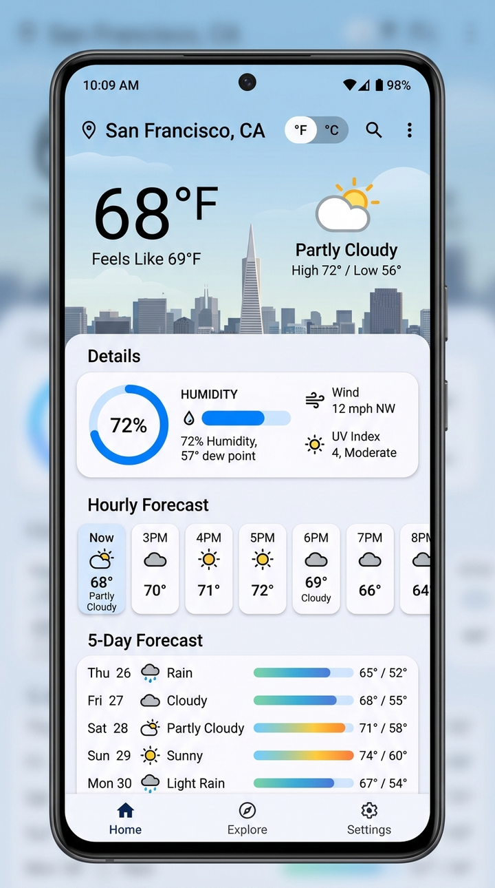

# SkyCast Weather 🌦️

A sleek, modern one-screen weather application for Android built with **Kotlin**, **Jetpack Compose**, and **Material Design 3**.

<div align="center">
  
  <p><em>Real-time temperature, humidity gauge, hourly forecast, and 5-day visual temperature range</em></p>
</div>

---

## Features

- **Real-Time Weather & Local Temperature**:
  - Live temperature readout with an instantaneous **°C / °F unit toggle**.
  - Weather condition indicator (*Sunny & Clear*, *Partly Cloudy*, *Overcast Clouds*, *Rain*, *Thunderstorm*, etc.).
  - Daily High / Low temperatures and "Feels like" metrics.
  - Animated dynamic atmospheric background canvas that reflects real-time weather conditions.

- **Dedicated Humidity Gauge**:
  - Large humidity percentage readout.
  - Comfort index indicator (*Dry Air*, *Optimal & Comfortable (40–60%)*, *Moderate Moisture*, *High Humidity*).
  - Visual progress gauge bar with status classifications.

- **5-Day Weather Forecast**:
  - 5-day cards with day names, dates, weather glyphs, and precipitation probabilities.
  - Dynamic horizontal temperature range gradient bars showing daily low-to-high temperature distribution across the week's span.
  - Interactive day inspection modal providing in-depth details (condition summary, humidity, precipitation likelihood, wind speed).

- **12-Hour Hourly Forecast**:
  - Horizontal scrolling carousel displaying the next 12 hours with temperatures and rain likelihood.

- **Additional Environmental Metrics**:
  - Wind speed (mph / km/h) and direction.
  - Atmospheric barometric pressure (hPa) and UV index ratings.

- **City Selector**:
  - Easily switch between locations (San Francisco, New York, London, Tokyo, Paris, Sydney).
  - Open-Meteo API integration with seamless offline fallback data.

- **Adaptive App Icon**:
  - Custom Material You adaptive launcher icon.

---

## Tech Stack & Architecture

- **Language:** [Kotlin](https://kotlinlang.org/)
- **UI Toolkit:** [Jetpack Compose](https://developer.android.com/jetpack/compose) (Material 3)
- **Architecture:** MVVM (Model-View-ViewModel) with StateFlow
- **Networking:** [Retrofit 2](https://square.github.io/retrofit/) & [OkHttp](https://square.github.io/okhttp/)
- **JSON Parsing:** [Moshi](https://github.com/square/moshi) with code generation
- **Data Source:** [Open-Meteo Weather API](https://open-meteo.com/) (zero-key public API)
- **Minimum SDK:** 24 (Android 7.0+)
- **Target SDK:** 36 (Android 16)

---

## Building and Running

1. Clone this repository:
   ```bash
   git clone https://github.com/saeed-dev-tech/skycast-weather.git
   cd skycast-weather
   ```
2. Open the project in **Android Studio (Ladybug or newer)**.
3. Sync Gradle and run the app on an Android device or emulator.
